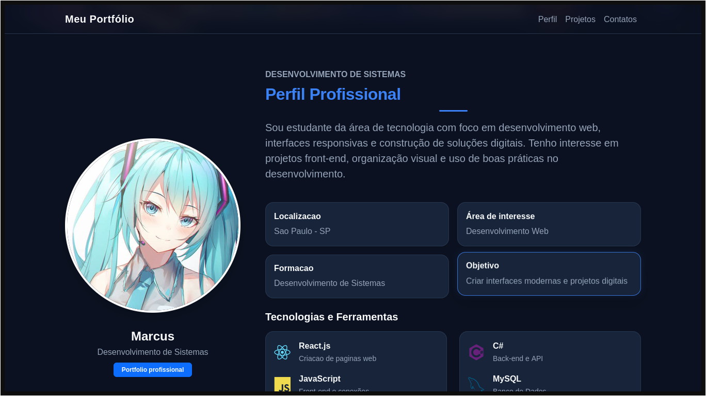

# Meu Portfolio   

Desenvolvido por Marcus.

## Sobre

Este é meu site de portfólio pessoal que desenvolvi com HTML e Bootstrap. Nele, compartilho um pouco sobre a minha formação, as ferramentas que utilizo e as experiências que adquiri como desenvolvedor de software. O site esta organizado pelas secoes Perfil, Projetos e Contatos, sendo possivel acessa-las pela barra de navegacao no topo.

## Tecnologias utilizadas

* HTML
* CSS
* Bootstrap

## Projetos em destaque

* BridgeMEI — Aplicação web para auxiliar microempreendedores individuais na gestão do negócio.
* Sistema de Biblioteca — Sistema de gerenciamento de livros desenvolvido em C++.
* API de Login — API de autenticação de usuários desenvolvida em C# com ASP.NET Core.

## Acesso

Você pode acessar meu portfólio pelo link: <a href="https://marcuss25.github.io/portfolio">Acessar Portfólio</a>